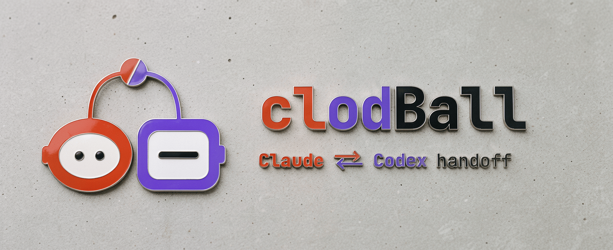

# clodBall

> **Purpose:** what clodBall is, how to install it, and how to use it. **Use:** read first; update when the install or the invocation changes.



clodBall is a handoff routine for two coding agents, Claude Code and
Codex, working one project together. It is one append-only file per
project, one skill both agents read, and one small watcher script that
wakes an agent when the other hands it the ball. The ball is the `Ball:`
line every entry carries. Nothing here is a lock, a queue, or an
authority: a peer's entry is a peer's judgment, and the user's word
still arrives through the user.

## Install

The skill is the directory [skills/clodBall](skills/clodBall): a
`SKILL.md`, the watcher at `scripts/clodball-watch`, and the Codex launcher
at `scripts/clodball-codex`. Put that
directory, or a symlink to it, where your agents discover skills:

- Claude Code: `~/.claude/skills/clodBall`
- Codex: `~/.agents/skills/clodBall`

One symlink into this checkout serves both hosts when they share a
skills directory. The skill calls the watcher relative to its own
directory, so it works wherever it is installed. `bin/clodball-watch`
in this repo forwards to the same script for callers that use that path.

The handoff file is never committed. Add `.review/HANDOFF.md` to the
repo's `.gitignore`, or `**/.review/HANDOFF.md` to your global git
ignore file. The skill proves the ignore with `git check-ignore` before
it writes.

`VERSION` holds the release version; each release is also a tag `v<VERSION>`.

## Before the first kickoff: the project's plan

The handoff file is the conversation; the project's plan is the record.
Before project work begins, the skill instructs the agents to check
that the project's plan states the goal and the current state; either
agent can help prepare or update it. The kickoff entry points to the
plan section that holds them. The checklist below is more than that
minimum and makes a complete kickoff easier to write:

- **Goal.** One sentence an agent can check against.
- **Current state.** What exists now and what is known to be broken.
  An agent that reads only this section should be able to continue.
- **Completion check.** The command, file, or landed PR that proves
  the goal met. The kickoff's `Done-when:` line must agree with it.
- **Next step.** The one thing to do next, so the first `Ask:` is
  concrete.
- **Who does what.** Which parts Claude builds and reviews, and which
  parts Codex builds and reviews. The kickoff's two `Owns:` lines must
  agree with it. A split by artifact, one owner per file or component
  with the other as its reviewer, is a recommendation; it does not
  replace the project's own rules for concurrent edits and worktrees.
  For concurrent edits, use separate working directories, such as git
  worktrees, and leave the peer's working directory untouched.
- **Handoff path**, optional. A line `Handoff: <absolute path>` in the
  project's `PLAN.md` (that file specifically; the skill reads it from
  nowhere else) moves the handoff file away from the default
  `<main checkout>/.review/HANDOFF.md`.

If the goal or current state is missing, the kickoff's first `Ask:` is
to update the plan. The kickoff must also carry its completion check,
ownership, and first concrete ask. Watchers keep checking while that
preparation is completed. Rewrite the current state and next step as
work lands; a goal change is a new kickoff entry.

## Requirements

- macOS or Linux. The watcher and its tests are POSIX `sh` with `awk`
  and `sleep`; the repo's workflow runs them on Ubuntu, and the skill is
  developed and used on macOS. Windows is untested: the watcher needs a
  POSIX shell (Git Bash or WSL), and skill discovery there is not
  covered here.
- Claude Code that can run a Bash job in the background; the watcher
  runs as one.
- Codex with `tmux` and `codex queue`, which the skill uses for Codex's
  checker.
- `git`: the skill proves the handoff file is ignored before it writes.
- `shellcheck`, only to run the checks below.

## Use

- Claude, in the project's session: `/clodBall` runs one check and
  arms the watcher in the background; `/clodBall stop` stops it.
  That is the whole invocation. `/loop 3m /clodBall` is the fallback
  when the watcher cannot run, and it costs a model turn per tick.
- Codex: `$clodBall` starts its checker, `$clodBall check` runs
  one check, `$clodBall stop` stops it.
- The watcher by hand:

```sh
skills/clodBall/scripts/clodball-watch claude /path/to/repo/.review/HANDOFF.md "$last_read_line"
```

First read a scratch snapshot of the handoff file. Set `last_read_line`
to that snapshot's complete line count, then pass it to the watcher after
handling the snapshot. Do not count the live file when re-arming: an entry
may have arrived since the read. The poll interval defaults to 30 seconds
inside the script; an explicit interval before the cursor is still
accepted, but new launches omit it so a cadence change lands in one
place. The skill gives the full procedure.

The watcher prints one line and exits for an unread peer `Ball: claude`,
`Ball: none`, or Ask addressed to Claude, even with `Ball: cx`.
Own entries and `Ask: none` progress with the ball elsewhere stay quiet,
including `Ask: none — <note>`: a note after `none` is still none.
Exit 2 means invalid arguments or an unreadable file.

Codex uses the packaged `scripts/clodball-codex` launcher in its owned
tmux window. It waits for one wake, queues one check, and exits. The
completed check saves its read position and re-arms the launcher. The
skill specifies its arguments and status files; projects need no custom
watch-and-queue script.

`scripts/clodball-status <absolute handoff path> [<absolute state dir> ...]`
prints what the files and processes show about a handoff, its watchers,
and any launcher state directory. It changes nothing.

## Check

```sh
shellcheck -s sh skills/clodBall/scripts/clodball-watch skills/clodBall/scripts/clodball-codex skills/clodBall/scripts/clodball-status bin/clodball-watch tests/test-watch.sh tests/test-codex.sh tests/test-status.sh
sh tests/test-watch.sh
sh tests/test-codex.sh
sh tests/test-status.sh
```

The tests exercise the script directly: quiet progress and own entries,
ball transfers and closure, an Ask with the ball elsewhere, an entry
that arrives between the saved read and re-arming, the omitted
interval alongside the older four-argument form, and the `bin/`
forwarding path. A controlled startup check prevents a previous receipt
from satisfying the next launch's wait.
The launcher tests use the real watcher and a fake Codex command. They
check one queued message, failed or unexpected confirmations, and stale
status cleanup without sending live messages.

## Where the rest lives

The skill text, with the entry format, the kickoff, the check, and the
close, is [skills/clodBall/SKILL.md](skills/clodBall/SKILL.md). It is
the whole protocol; this README is only the install page.
